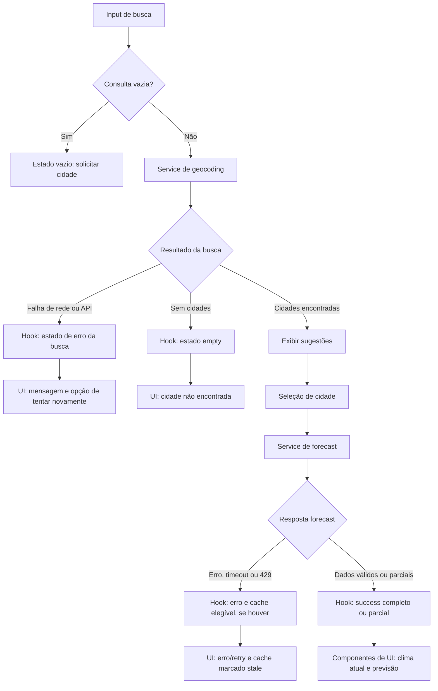

# Plano Técnico — Weather App

Este plano deriva de [`specs/weather-app-spec.md`](../specs/weather-app-spec.md), que é a fonte da verdade para o comportamento e os limites do produto. Os blocos TypeScript abaixo definem contratos pretendidos, não código final.

## Architecture

Aplicação cliente React, sem backend próprio na primeira versão. As dependências seguem uma direção: apresentação → orquestração → serviços → APIs/armazenamento. Funções puras em `lib/` podem ser chamadas pelas camadas superiores, mas não fazem I/O nem dependem de React. Os tipos compartilhados definem contratos entre as camadas.

```text
components (UI, eventos e acessibilidade)
  ↓ ações e props/estado
hooks (orquestração, estado e ciclo de vida)
  ↓ chamadas pelos contratos
services (Fetch, parsing, validação, normalização e storage)
  ↓ I/O                         ↘ usa funções puras
Open-Meteo / localStorage         lib (regras e formatação)
         ↘ dados de domínio / resultados
         hooks → components
```

- **`components/`** apresenta busca, cidade, clima, previsão e estados de loading/erro/vazio. Recebe dados e callbacks tipados; não conhece endpoints, `localStorage` ou formato bruto do provedor.
- **`hooks/`** coordena busca, seleção, chamadas, concorrência, atualização por visibilidade e estado de tela. Possui efeitos e timers de React; consome interfaces de serviço, sem implementar HTTP.
- **`services/`** isola os efeitos externos: `openMeteo` executa Fetch e converte respostas para os tipos de domínio; `weatherStorage` lê/grava preferências e cache. Não importa componentes ou hooks.
- **`lib/`** contém funções determinísticas sem efeitos, como conversão/arredondamento, atualidade, códigos WMO e formatação por locale/fuso. Recebe entradas explícitas e retorna resultados, sem ler relógio, DOM ou storage implicitamente.
- **`types/`** reúne contratos compartilhados, sem lógica de apresentação ou I/O.
- `App.tsx` compõe componentes e hook; `main.tsx` inicializa React. Não criar camada de contexto/global store: o estado desta tela cabe no hook.
- **Integração incremental atual:** `main.tsx` inicia em `idle` e injeta `getWeatherByName`, que encadeia geocoding e forecast somente para correspondência única com contexto completo. Resultados ambíguos são recusados com mensagem explícita, não selecionados arbitrariamente; isso não substitui a seleção explícita planejada. O mock padrão de `App` permanece disponível em demonstrações/testes isolados. O setup de testes carrega os matchers e cleanup do Testing Library; E2E fixa o relógio da fixture e intercepta a rede.
- O endpoint de previsão retorna clima atual e previsão diária na mesma chamada, reduzindo volume de chamadas e mantendo seus dados associados à mesma resposta.
- A aplicação funciona sem serviço remoto para persistir usuários ou dados. Não solicitar geolocalização nem enviar telemetria de uso.

## Tech Stack

| Tecnologia | Uso e justificativa |
| --- | --- |
| TypeScript strict | Contratos explícitos para respostas incompletas e ausência de valores. |
| React 19 + Vite | UI e servidor/build já definidos no repositório. |
| Tailwind CSS 3 | Estilo responsivo com o tema dark glassmorphism definido nas instruções do projeto. |
| Open-Meteo Geocoding e Forecast | Fonte definida na spec; chamadas diretas, sem chave, somente para o protótipo controlado não comercial. |
| Vitest + Testing Library | Testes unitários e de interação, já disponíveis no projeto. |
| Playwright | Fluxos E2E e viewports, já disponível no projeto. |
| Biome + pnpm | Lint/formatação e gerenciador definidos no repositório. |

Não adicionar biblioteca de cache, estado global, data fetching ou datas nesta versão: React, Fetch, `Intl` e `localStorage` bastam para o escopo.

## Project Structure

Estrutura proposta, alinhada ao README do repositório e às responsabilidades das camadas:

```text
src/
├── components/
│   ├── states/              # estados reutilizáveis de loading, vazio e erro
│   ├── CitySearch.tsx       # entrada, sugestões e seleção acessível
│   ├── CurrentWeather.tsx   # condições atuais e atualidade
│   ├── Forecast.tsx         # previsão diária
│   └── UnitToggle.tsx       # preferência °C/°F
├── hooks/
│   └── useWeather.ts        # coordenação de estado, efeitos e atualização
├── services/
│   ├── openMeteo.ts         # Fetch, parsing, validação e normalização
│   └── weatherStorage.ts    # persistência local de preferência e cache
├── lib/
│   ├── weatherCodes.ts      # código WMO → condição em pt-BR
│   ├── temperature.ts      # conversão e arredondamento
│   └── formatting.ts       # Intl para datas, horas e números
├── types/
│   └── weather.ts           # contratos compartilhados entre camadas
├── styles/                  # Tailwind e estilos globais
├── App.tsx                  # composição e avisos permanentes de fonte/limites
└── main.tsx                 # bootstrap React
```

Manter um componente por arquivo. Evitar abstrações adicionais até que uma necessidade real apareça. Manter os testes em `tests/`, organizados por unidade (lib, services, hooks e componentes) e E2E; não é necessário espelhar toda a árvore de produção.

### Por que separar e como testar

- **Apresentação:** componentes recebem props tipadas e podem ser testados com Testing Library sem rede, relógios ou persistência reais; validar renderização, teclado e estados visíveis.
- **Orquestração:** testar o hook com serviços simulados, relógio/timers controlados e eventos de visibilidade; verificar concorrência, retry e transições sem depender de React na lógica de domínio.
- **Acesso a dados:** testar serviços isoladamente com Fetch e storage simulados; conferir URLs, parâmetros, parsing, campos ausentes, erros HTTP, timeout e normalização.
- **Funções puras:** testar `lib/` com entradas e saídas determinísticas, incluindo limites de arredondamento, atualidade, datas e valores inválidos; estes testes são rápidos e não precisam de mocks de I/O.
- **Integração:** reservar Playwright para fluxos completos e responsividade. Assim, a maioria dos casos fica em testes unitários rápidos, e E2E cobre apenas contratos entre camadas e experiência real.

## Data Model

Dados internos de temperatura permanecem em Celsius; conversão para Fahrenheit ocorre na apresentação, sem nova chamada. Números meteorológicos ausentes são `null`, nunca zero. Datas do provedor são mantidas como strings ISO/data local até serem interpretadas com o fuso IANA correspondente.

```ts
type TemperatureUnit = 'celsius' | 'fahrenheit';

interface City {
  id: string;
  name: string;
  admin1: string | null;
  country: string | null;
  latitude: number;
  longitude: number;
}

interface CurrentWeather {
  // Instante normalizado em UTC a partir do horário local da API e seu offset.
  referenceTime: string | null;
  temperatureC: number | null;
  apparentTemperatureC: number | null;
  humidityPercent: number | null;
  windKmh: number | null;
  precipitationMm: number | null;
  weatherCode: number | null;
  modelRunAt: string | null;
}

interface ForecastDay {
  localDate: string;
  weatherCode: number | null;
  minimumC: number | null;
  maximumC: number | null;
}

interface WeatherSnapshot {
  city: City;
  timezone: string;
  current: CurrentWeather;
  forecast: ForecastDay[];
  fetchedAt: string;
}

interface WeatherCacheEntry {
  snapshot: WeatherSnapshot;
  storedAt: string;
}

interface Preferences {
  lastCity: City | null;
  temperatureUnit: TemperatureUnit;
}
```

`City.id` é uma chave interna estável derivada da identidade e coordenadas do resultado, sem depender de um ID opcional do provedor. Um resultado só é convertível em `City` se tiver nome não vazio e coordenadas finitas dentro dos limites geográficos. Se esses campos forem válidos, a pessoa pode selecioná-lo explicitamente mesmo sem contexto geográfico completo; seleção automática exige exatamente um resultado válido com `admin1` e `country` não vazios. Resultados sem nome ou coordenadas válidas não são selecionáveis. Empates na ordenação mantêm o índice original retornado pelo provedor.

Busca e meteorologia mantêm estados separados para que editar a busca não apague a cidade exibida. Busca sem resultados usa `empty`; erro HTTP 429 continua sendo `error` com retry manual desabilitado até `retryAt`, sem um estado global adicional de bloqueio. Dados de cache são identificados como `stale`, preservando o horário meteorológico de origem.

## Data Flow



1. Ao iniciar, ler preferências locais; usar Celsius se a unidade estiver ausente ou inválida. Restaurar a última cidade e solicitar seus dados. Cache não é apresentado como atual sem uma falha elegível (RF4, RF5, RF8).
2. Na busca, remover espaços apenas das extremidades; entrada vazia não chama a API. Preservar acentos e pontuação. Aplicar debounce de 300 ms após a última edição e limitar cada resposta a 10 sugestões; não impor quantidade mínima de caracteres. Cancelar a requisição anterior quando possível e descartar respostas tardias, contabilizando cada chamada no orçamento do piloto.
3. Ordenar localmente os resultados por igualdade exata, prefixo e ocorrência parcial, sem alterar a ordem do provedor dentro de cada grupo. Selecionar automaticamente somente uma correspondência válida com contexto geográfico completo; nos demais casos, aguardar escolha explícita (RF1).
4. Ao selecionar uma cidade, persistir essa última cidade e consultar Forecast API; normalizar clima atual, fuso e registros diários. A seleção permanece lembrada mesmo se a consulta falhar. A lista esperada contém cinco datas locais consecutivas; respostas incompletas não são preenchidas artificialmente (RF2, RF3, RF5, RF9).
5. Antes de declarar sucesso, interpretar `current.time` como horário local do provedor e normalizá-lo para um instante UTC usando `utc_offset_seconds` da mesma resposta; nunca deixar `Date` interpretar a string sem offset no fuso do dispositivo. Validar esse instante contra o relógio atual: não pode ser futuro e deve ter no máximo 60 minutos. Usar `timezone` IANA apenas para exibição local. A idade da execução do modelo é independente; sem metadado confiável, permanece `null` e é apresentada como “Indisponível”.
6. Renderizar valores disponíveis; campos ausentes aparecem como “Indisponível”. Converter temperatura para a unidade preferida e só então arredondar ao inteiro mais próximo, com empates afastados de zero. Datas são calculadas no calendário local da cidade.
7. Em resposta válida, atualizar cidade e cache local. Em falha, procurar cache da cidade com `storedAt` de até três horas e timestamp de referência parseável e não futuro; exibi-lo como desatualizado, não como atual. Sem cache elegível, mostrar erro e nova tentativa (RF8).

## External APIs

**Geocoding**

- URL base: `https://geocoding-api.open-meteo.com/v1/search`.
- Exemplo: `https://geocoding-api.open-meteo.com/v1/search?name=S%C3%A3o%20Paulo&count=10&language=pt&format=json`.
- Parâmetros relevantes: `name` recebe a consulta aparada, sem remover acentos ou pontuação; `count=10` limita sugestões; `language=pt` pede nomes/localizações em português quando disponíveis; `format=json` explicita o formato. `current`, `daily` e `timezone` não se aplicam a este endpoint.
- Resposta resumida:

```json
{
  "results": [
    {
      "id": 3448433,
      "name": "São Paulo",
      "latitude": -23.5475,
      "longitude": -46.63611,
      "country": "Brazil",
      "admin1": "São Paulo"
    }
  ]
}
```

- Mapeamento: cada `results[]` válido origina um `City`: `name`, `admin1` e `country` são strings ou `null`; `latitude`/`longitude` são números validados. O `id` numérico do provedor é opcional e não integra o contrato do app; `City.id` é uma chave interna derivada da identidade e coordenadas. Resultado sem nome ou coordenadas válidas não é selecionável. `results` vazio ou ausente vira estado sem resultados, não um `City` fictício.
- O serviço de domínio ordena resultados por correspondência exata, prefixo e ocorrência parcial, mantendo a ordem recebida dentro de cada grupo (RF1).

**Forecast**

- URL base: `https://api.open-meteo.com/v1/forecast`.
- Exemplo: `https://api.open-meteo.com/v1/forecast?latitude=-23.5475&longitude=-46.63611&current=temperature_2m,apparent_temperature,relative_humidity_2m,wind_speed_10m,precipitation,weather_code&daily=weather_code,temperature_2m_min,temperature_2m_max&timezone=auto&temperature_unit=celsius&wind_speed_unit=kmh&precipitation_unit=mm&forecast_days=5`.
- Parâmetros relevantes: `latitude`/`longitude` vêm da cidade escolhida; `current` e `daily` enumeram os campos necessários; `timezone=auto` solicita o fuso IANA local; `temperature_unit=celsius`, `wind_speed_unit=kmh` e `precipitation_unit=mm` fixam as unidades de transporte; `forecast_days=5` solicita hoje e os quatro dias seguintes. A preferência Fahrenheit é aplicada localmente e não altera essa chamada.
- Resposta resumida (valores ilustrativos):

```json
{
  "timezone": "America/Sao_Paulo",
  "utc_offset_seconds": -10800,
  "current": {
    "time": "2026-11-05T10:00",
    "temperature_2m": 18.4,
    "apparent_temperature": 19.1,
    "relative_humidity_2m": 72,
    "wind_speed_10m": 12.6,
    "precipitation": 0,
    "weather_code": 2
  },
  "daily": {
    "time": ["2026-11-05", "2026-11-06"],
    "weather_code": [2, 61],
    "temperature_2m_min": [16.2, 17.0],
    "temperature_2m_max": [25.1, 23.8]
  }
}
```

- Mapeamento para o modelo: `WeatherSnapshot.timezone` recebe `timezone`; `city` é a `City` selecionada; `fetchedAt` é o instante local em que a resposta válida foi recebida, não um campo da API. Normalizar `current.time` com o `utc_offset_seconds` da mesma resposta para ISO UTC em `CurrentWeather.referenceTime`, comparável sem depender do fuso do dispositivo; usar `timezone` IANA para exibir HH:mm. Validar a semântica do offset do provedor em testes de contrato, inclusive próximo a mudança de horário. Os valores de `temperature_2m`, `apparent_temperature`, `relative_humidity_2m`, `wind_speed_10m`, `precipitation` e `weather_code` vão respectivamente para `temperatureC`, `apparentTemperatureC`, `humidityPercent`, `windKmh`, `precipitationMm` e `weatherCode`.
- Para `ForecastDay[]`, parear pelo índice de `daily.time`: data para `localDate`, código para `weatherCode`, `temperature_2m_min` para `minimumC` e `temperature_2m_max` para `maximumC`. Validar comprimentos dos arrays; não criar registros nem valores ausentes. `null` representa campo ausente/inválido no modelo.
- O código WMO é traduzido para condição em pt-BR pela aplicação; código desconhecido ou ausente não deve produzir condição inventada. A amostra da spec não encontrou timestamp confiável de execução do modelo: manter `CurrentWeather.modelRunAt` como `null`; não inferi-lo de `generationtime_ms`, `current.time` ou do instante de busca.

As duas bases são chamadas diretamente do navegador, sem chave no protótipo não comercial. Aplicar timeout total de cinco segundos às chamadas de dados e sinalizar erros HTTP, rede, parsing e validação. HTTP 429 não gera repetição automática.

## State Management

- O estado transitório vive no hook `useWeather`; manter busca e meteorologia independentes para uma nova busca não apagar a cidade já exibida. O texto digitado pode permanecer local em `CitySearch`, pois é estado efêmero de interface.
- Busca e meteorologia usam contratos de estado separados: `idle`, `loading`, `success`, `empty` e `error`. Em busca, `success` contém sugestões e `empty` indica lista vazia. Em meteorologia, `success` contém snapshot completo ou parcial e sinalizador `stale`; erros podem conter fallback de cache elegível. Isso evita forçar metadados de clima em resultados de geocoding.

```ts
type SearchError =
  | { kind: 'network' }
  | { kind: 'api'; status: number }
  | { kind: 'timeout' }
  | { kind: 'rate-limit'; retryAt: number };

type SearchState =
  | { status: 'idle' }
  | { status: 'loading' }
  | { status: 'success'; results: City[] }
  | { status: 'empty' }
  | { status: 'error'; error: SearchError };

type WeatherState =
  | { status: 'idle' }
  | { status: 'loading' }
  | { status: 'success'; data: WeatherSnapshot; completeness: 'complete' | 'partial'; stale: boolean }
  | { status: 'error'; error: WeatherError; retryAt?: number; fallback?: WeatherSnapshot };
```

São contratos conceituais, mantidos no hook local sem biblioteca de estado global. No fluxo meteorológico, `fallback` só é preenchido por cache elegível e deve ser exibido como desatualizado, sem ocultar o erro da consulta atual. HTTP 429 permanece em `error` com `retryAt`; não requer estado `blocked` adicional.

- Estado durável mínimo em `localStorage`: unidade e última cidade selecionada. Validar o conteúdo ao ler; valores inválidos voltam aos padrões sem impedir a inicialização.
- Cache meteorológico local contém somente `WeatherSnapshot` e `storedAt`, associado à cidade. Usar uma única entrada para a última cidade é suficiente para a primeira versão e limita armazenamento; trocar de cidade substitui essa entrada.
- Não persistir consulta digitada, histórico, dados pessoais ou informações de sessão em servidor. Não implementar analytics.
- Um único temporizador é suficiente: atualizar 15 minutos após o início da tentativa anterior. Pausar enquanto `document.visibilityState` for hidden; ao voltar, atualizar imediatamente se o prazo venceu. Uma consulta em andamento para a mesma cidade atende solicitações concorrentes, inclusive atualização manual. Ao trocar de cidade, cancelar quando possível e descartar respostas tardias que não correspondam à seleção vigente (RF7).
- Temperaturas são mantidas em Celsius no modelo. Na renderização, derivar Celsius diretamente ou converter para Fahrenheit com `F = C × 9/5 + 32`; depois arredondar ao inteiro mais próximo, com empates afastados de zero. Não gravar valores convertidos nem refazer o request ao alternar unidade. A preferência °C/°F persiste localmente; vento permanece em km/h e precipitação em mm (RF2, RF4).

## Error Handling

### Incremento no modo de demonstração

O fluxo atual continua usando `getMockWeather`, sem integrar a seleção de cidades à API real.
O hook `useWeather` concentra os estados da consulta por nome, encerra o carregamento
em cinco segundos e repete somente a consulta que falhou quando a pessoa aciona
“Tentar novamente”, mesmo após editar o campo. Uma resposta tardia não substitui
o resultado da nova tentativa; requisições HTTP reais também são abortadas após
cinco segundos pelo serviço. O loader de demonstração não oferece cancelamento.
As mensagens distinguem timeout, falha de conexão, HTTP e JSON inválido.
Cache, seleção de cidades, atualização e bloqueio por `Retry-After` continuam no
escopo das tarefas de integração, não deste incremento.

Validação offline: Vitest simula `fetch` rejeitando com `TypeError`, verifica
mensagem de conexão e recuperação via retry; timers falsos verificam o limite
de 5.000 ms e o descarte de resposta tardia. Após a integração à API real,
adicionar E2E com `context.setOffline(true)` depois de carregar a página,
confirmar o alerta, restaurar a conexão com `context.setOffline(false)` e acionar
retry, verificando a mesma operação e a remoção do erro. Alternativamente,
usar `page.route` com `route.abort('internetdisconnected')` para isolar cada endpoint.
No modo de demonstração, desconectar a rede não provoca falha de consulta.

Classificar erros com um tipo de domínio, traduzido em mensagem curta e ação adequada na interface. Detalhes técnicos podem ser registrados somente em desenvolvimento; não registrar cidade ou consulta em telemetria. Uma falha da busca anterior ou de outra cidade não pode substituir o estado da consulta vigente.

```ts
type WeatherError =
  | { kind: 'network' }
  | { kind: 'api'; status: number }
  | { kind: 'timeout' }
  | { kind: 'invalid-data'; reason: 'stale-reference' | 'invalid-timezone' | 'invalid-response' }
  | { kind: 'rate-limit'; retryAt: number };
```

| Situação | Comportamento |
| --- | --- |
| Rede indisponível | Encerrar loading, informar falha de conexão e oferecer nova tentativa; avaliar cache elegível. |
| Erro HTTP/API diferente de 429 | Encerrar loading, apresentar erro compreensível e oferecer retry; não inventar dados. Aplicar fallback de cache se elegível. |
| Timeout | Limitar a consulta inteira a cinco segundos desde seu início; sem resposta válida no prazo, abortar via `AbortController`, definir erro `timeout`, oferecer retry e avaliar cache (RF8). |
| HTTP 429 | Não repetir automaticamente. Interpretar `Retry-After` como segundos ou data HTTP; desabilitar retry manual até o prazo indicado. Se ausente/inválido, aguardar 60 segundos. Aplicar cache elegível (RF8). |
| Resposta parcial | Não é erro de rede/API: definir `success` com `completeness: 'partial'`, renderizar dias e campos recebidos, indicar ausências como “Indisponível” e sinalizar previsão incompleta. Não preencher com zero nem fabricar dias (RF2, RF3). |
| Horário/fuso inválido ou referência antiga | Tratar como dado inválido, não como clima atual. Informar atualidade indisponível/desatualizada, oferecer retry e aplicar regras de cache. Horário futuro, inválido ou com mais de 60 minutos não é atual (RF2). |
| Busca sem resultados | Definir estado `empty`, informar que a cidade não foi encontrada e permitir nova consulta. Não confundir com erro de API; consulta vazia não é enviada (RF1). |
| Falha ao ler cache/preferências | Ignorar registro inválido e continuar sem persistência, usando Celsius e fluxo normal; não travar a aplicação. |

Cache elegível em qualquer falha: `storedAt` parseável com idade não negativa de até três horas, inclusive, e timestamp meteorológico de origem parseável e não futuro. O prazo é contado desde `storedAt`, não da referência meteorológica. Apresentar cache elegível com indicação stale e horário meteorológico de origem; sem cache elegível, não exibir dados antigos. Atualizações válidas substituem o cache; respostas inválidas não o promovem a dado atual (RF8).

## Testing Strategy

- **Melhorias incrementais de performance/UX (AC42):** manter a gestão condicional de foco no conteúdo após busca/retry, sem roubar foco nem focar na montagem inicial; expor `aria-busy` no conteúdo durante loading e restringir hover a botões habilitados. Memoizar somente a validação de completude da previsão com dependências `forecast`, `timezone` e `referenceTime`, evitando recriar formatadores nessa validação ao alternar unidades. Cobrir transições de busy/foco e atualização das entradas da previsão com Testing Library; não adicionar memoização generalizada de componentes ou callbacks.

- **Vitest — funções puras (`lib/`):** conversão °C/°F, conversão antes do arredondamento e empates afastados de zero; códigos WMO conhecidos/desconhecidos; ordenação estável e elegibilidade de seleção; normalização do horário local com o offset do provedor; formatação pt-BR/24h e datas no fuso da cidade; atualidade nos limites de 60 minutos; TTL de cache de três horas; interpretação de `Retry-After`. Usar entradas fixas e relógio controlado, sem rede ou DOM.
- **Vitest — services:** substituir `fetch` por mock e validar URL/parâmetros, parsing e normalização de respostas geocoding/forecast, valores ausentes, arrays diárias incompletas, HTTP, rede, timeout/abort e `429`. Mockar storage para validar serialização, dados inválidos e fallback de cache. Não chamar o serviço real nos testes automatizados.
- **Vitest + Testing Library — componentes:** renderizar e verificar estados `loading`, `error`, `empty` e `success`, inclusive sucesso parcial e cache stale; textos de indisponibilidade, retry, sugestões acessíveis, teclado e alternância de unidade. Os componentes recebem dados/props ou serviços simulados; conferir que clicar °C/°F altera a apresentação sem disparar novo fetch.
- **Vitest — hook/orquestração:** testar transições de estado, debounce/cancelamento da busca, concorrência coalescida, respostas tardias ignoradas, atualização manual, temporizador de 15 minutos, pausa/retomada por visibilidade, persistência de preferências e bloqueio manual em `429`. Controlar relógio, timers, visibilidade e dependências para resultados determinísticos.
- **Playwright — E2E:** percorrer busca → escolha de cidade → clima atual/previsão; resolver cidade homônima explicitamente; verificar aviso sobre previsões/alertas e atribuição Open-Meteo (AC17/AC18); confirmar estados de loading, vazio e erro; testar cache após falha, retry, alternância de unidade persistida após reload e ausência de uma chamada meteorológica causada somente pela troca de unidade. Interceptar Open-Meteo para fixtures previsíveis e simular sucesso, parcial, falha, timeout e `429`.
- **Playwright — responsividade mobile:** executar os fluxos essenciais em 320 e 375 CSS px, conferindo ausência de rolagem horizontal, conteúdo cortado e controles inacessíveis. Cobrir também as larguras da spec (768, 1024 e 1440 px) para os estados/telas do AC49. Complementar E2E com teclado e avaliação manual de leitores de tela/navegadores conforme NFR4 e NFR7.
- **Operação e lançamento:** distinguir latência/renderização da interface da latência do provedor; avaliar LCP segundo o limiar amostral da spec e disponibilidade sintética da interface. Métricas reais ficam desativadas até aprovações de privacidade; validar orçamento de 1.000 chamadas no piloto por processo operacional, contando geocoding, previsão e tentativas.
- **Validação de produto (AC46):** atividade de pesquisa separada dos testes automatizados. Após definir recrutamento e protocolo, medir a tarefa com 30 participantes; considerar a meta atingida com pelo menos 27 conclusões corretas em até 30 segundos. Critérios de recrutamento permanecem uma questão aberta da spec.
- Scripts previstos no repositório: `pnpm lint`, `pnpm build`, `pnpm test` e, para E2E, `pnpm test:e2e`.

## Risks & Trade-offs

| Trade-off | Decisão e alternativa considerada |
| --- | --- |
| API gratuita direta no navegador não garante disponibilidade; volume pode exceder termos/limites. | Usar acesso direto apenas no protótipo não comercial controlado, com orçamento de 1.000 chamadas. Alternativa: backend/proxy com controle centralizado ou plano/licença próprio; necessário antes de publicação pública ou uso comercial (RF6, NFR9; AC51, AC54, AC55). |
| Horário de referência não equivale necessariamente a observação nem à execução do modelo. | Usar rótulo neutro e janela de 60 minutos; idade do modelo separada e indisponível sem metadado confiável. Alternativa rejeitada: inferir atualização do modelo a partir de `current.time` ou `generationtime_ms`, pois a spec proíbe essa inferência (RF2, NFR6). |
| Resultado único de geocoding pode não ter contexto suficiente para identificação segura. | Exigir nome e coordenadas válidas e seleção explícita quando faltar contexto. Alternativa rejeitada: selecionar sempre o primeiro resultado, que pode apontar para cidade homônima (RF1). |
| Estado global e camada de dados robusta aumentariam dependências para uma única tela. | Usar hook local e `fetch` encapsulado em service. Alternativas consideradas: biblioteca global (Redux/Zustand) ou de data fetching/cache (TanStack Query); não adotadas porque o escopo atual cabe nas APIs React/nativas e adicioná-las aumentaria abstração e dependências sem requisito correspondente. |
| Cache local simples não retém clima para várias cidades. | Manter uma entrada da cidade mais recente, suficiente para o fallback da spec. Alternativa: cache multi-cidade/IndexedDB, que amplia invalidação e gestão sem benefício requerido (RF5, RF8). |
| Preferência Fahrenheit pode ser aplicada pelo provedor ou no cliente. | Manter Celsius como unidade canônica e derivar Fahrenheit na apresentação, sem novo request. Alternativa: refazer a consulta ou manter duplicadas as duas representações; ambas adicionam chamadas/estado e risco de divergência (RF4). |
| Testes E2E contra APIs reais são instáveis e dependem de rede/cobertura. | Interceptar chamadas com fixtures em Playwright e mockar `fetch` em Vitest. Alternativa: depender do Open-Meteo real em cada execução; manter smoke test real manual/operacional separado, não como requisito de cada build. |
| Fuso IANA e datas locais podem divergir do fuso do dispositivo. | Usar `timezone` do provedor com `Intl` e validar virada do dia. Alternativa rejeitada: usar apenas o fuso local do navegador, que pode mostrar dia incorreto para a cidade (RF9). |
| Recrutamento da validação AC46 e metas pós-baseline ainda não foram definidos. | Registrar como pendências de produto, sem inventar critérios ou SLOs técnicos (Open Questions 1 e 2 da spec). |
| Contas, offline completo, telemetria e alertas estão fora do escopo atual. | Não incluí-los; alternativas ficam para revisão de escopo futura. Manter aviso de limites e atribuição da fonte (RF6; Out of Scope). |

**Fora do MVP / próximos lançamentos:** não implementar coleta de métricas reais nesta versão. Caso métricas reais de performance/disponibilidade sejam aprovadas depois, exigir revisão de privacidade e consentimento aplicável, dados agregados sem cidade, unidade ou identificador pessoal e exclusão após 90 dias. Também ficam para uma fase futura, se o uso justificar, proxy/backend para quota central, cache multi-cidade e biblioteca de estado/data-fetching. Estas opções não são pré-requisitos para o protótipo controlado; gates de segurança, termos e operação continuam obrigatórios antes de publicação pública, conforme NFR8/NFR9.

Antes de qualquer publicação, concluir as revisões de segurança, privacidade e termos/licença definidas em NFR8/NFR9. A spec não fornece endpoints de backend, credenciais, SLO para a API ou estratégia de uso comercial; este plano não os presume.